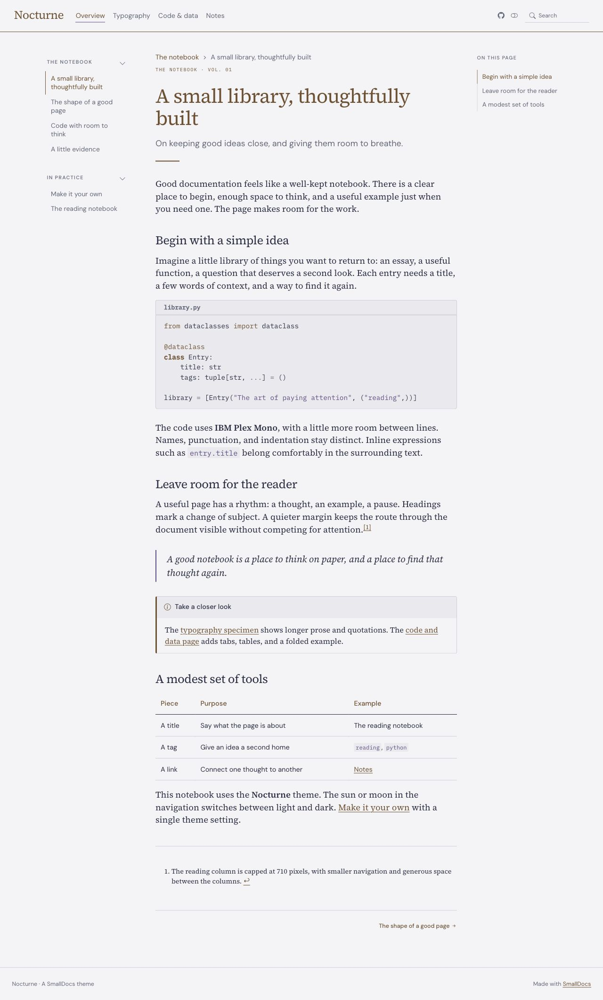
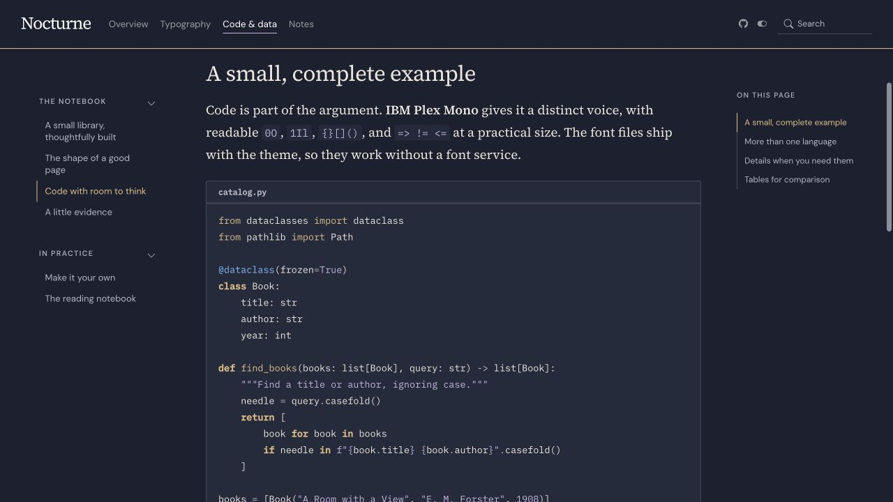

# smalldocs-nocturne

Midnight ink, warm brass, and a literary serif. Made for focused reading, with a pearl-paper light mode. A complete [SmallDocs](https://github.com/rahuldave/smalldocs)
theme with light and dark modes, bundled fonts, and a corresponding Quarto extension.

**[See the example site](https://rahuldave.com/smalldocs-nocturne/)** ·
[Light](https://rahuldave.com/smalldocs-nocturne/?mode=light) ·
[Dark](https://rahuldave.com/smalldocs-nocturne/?mode=dark)

| Light | Dark |
|:------|:-----|
|  |  |

The screenshots show `v0.2.0`, including its earlier title label. Current builds
omit that label by default; the handbook below shows how to restore it.

Code uses **IBM Plex Mono** in both modes. Fonts ship with the extension; the theme
makes no requests to an external font service. The reading column is 640px wide,
with smaller navigation and a compact table of contents.

[Theme handbook and optional effects](https://rahuldave.com/elegant-themes/theme-guide.html#nocturne)

## With SmallDocs

In your documentation project:

```sh
smalldocs add rahuldave/smalldocs-nocturne
```

Set the theme in `_smalldocs.yml`:

```yaml
theme: nocturne
```

In a `_quarto.yml` that SmallDocs builds, put the setting under `smalldocs:`:

```yaml
smalldocs:
  theme: nocturne
```

The normal SmallDocs navigation button switches between light and dark.
Installing the theme requires no Sass compiler or font downloads.
`smalldocs themes` lists the project's installed themes.

## Update or choose a version

The reading refinement began with **0.2.0** and keeps the configuration name `nocturne`.
The current default branch removes the fixed label above every page title.
SmallDocs copies an extension into your project; it does not update that copy automatically.
To replace an older installation with the current theme:

```sh
smalldocs add rahuldave/smalldocs-nocturne --force
smalldocs render
```

Keep `theme: nocturne`. `--force` replaces `_extensions/nocturne/`; keep local theme changes
in your site's own stylesheet before updating. Commit the installed extension with your site.
`smalldocs themes` shows the installed source and commit.

Add `@v0.2.0` to pin the reading refinement before the label cleanup.
That release and the original snapshot still contain the fixed label. To restore the original:

```sh
smalldocs add rahuldave/smalldocs-nocturne@before-reading-redesign-2026-10-16 --force
```

[Installation and version guide](https://rahuldave.com/elegant-themes/using-themes.html) ·
[Compare original and refined themes](https://rahuldave.com/elegant-themes/?group=comparisons)

## With Quarto

```sh
quarto add rahuldave/smalldocs-nocturne
```

```yaml
format:
  nocturne-html:
    toc: true
```

Quarto uses layered Sass and embeds the fonts as data URIs. Its theme follows the
browser's color preference and supports Quarto's light/dark toggle.

## Optional title label

The theme leaves title text to your page. To restore the earlier decorative label,
follow the [stylesheet recipe in the theme handbook](https://rahuldave.com/elegant-themes/theme-guide.html#nocturne).
Keep the rule in your own `styles.css` so a theme update preserves your choice.
The [example installation page](example/pages/install.qmd#optional-title-label) also includes the recipe.

## Editable sources and builds

The compiled files in `_extensions/nocturne/` are committed for installation. Edit
`src/` and rebuild them; do not edit the compiled files by hand.

| Source | Purpose |
|:-------|:--------|
| `src/theme.json` | Both palettes, heading and body font choices, and theme metadata |
| `src/common.css` | Typography, navigation, code, tables, figures, callouts, and listings |
| `src/design.css` | Nocturne's distinctive headings, rules, and spacing |
| `src/fonts.css` | Local font-face declarations |
| `src/font-sources.json` | The pinned upstream URLs of the bundled font files |
| `src/quarto.css` | Adaptations for Quarto's own layout |
| `src/smalldocs.yml`, `src/_extension.yml`, `src/logo.svg` | Authored extension manifests and favicon |
| `vendor/bootstrap/` | Bootstrap 5.3.8 and its MIT license |
| `vendor/fonts/` | Original font files and their SIL Open Font License notices |
| `scripts/build.py`, `scripts/dark_root.py` | Offline, reproducible theme build and Bootstrap dark-mode adaptation |

Build with Python's standard library, from any directory:

```sh
sh scripts/build.sh
```

This writes two complete Bootstrap stylesheets (`nocturne.css` and `nocturne-dark.css`),
two layered Quarto Sass files (`nocturne.scss` and `nocturne-dark.scss`), manifests,
fonts, and licenses into `_extensions/nocturne/`. Like the Tufte theme, each CSS file
contains all of Bootstrap, so it can also replace `bootstrap.min.css` on an
ordinary Bootstrap page. Keep its `fonts/` folder beside it.

Normal builds work offline. `python3 scripts/fetch_fonts.py` can restore the
bundled font files from the exact upstream URLs in `src/font-sources.json`.

## The example site and GitHub Pages

`example/` contains the editable Markdown pages and `_smalldocs.yml`. It is a
normal SmallDocs website, with typography, code, figures, and a notes listing.

```sh
uv sync --group dev
uv run python scripts/build_demo.py
```

That script rebuilds the theme, copies it into the ignored `example/_extensions/`
folder, and runs `smalldocs render example --strict`. The HTML goes to
`example/_site/`; no HTML is hand-maintained.

To use the theme installer against this repository's current commit instead:

```sh
smalldocs add . --dir example --force
smalldocs render example --strict
```

Publish the rendered site to the separate `gh-pages` branch, as in
[smalldocs-tufte](https://github.com/rahuldave/smalldocs-tufte):

```sh
uv run smalldocs publish gh-pages example --no-render
```

GitHub Pages serves `gh-pages` from `/`. The source branch is `main`. The ignored
build output and copied extensions are kept out of `main`.

`just serve` builds and serves a local preview. `just publish` builds and publishes.

## Checks

```sh
uv run pytest -q
```

The tests check Bootstrap's component and variable contract, both color modes,
local fonts and asset paths, and installation into a fresh SmallDocs site. GitHub
Actions also rebuilds the theme and fails if the compiled files differ from their
sources, then renders the example site with strict checks.

## Credits and licenses

Theme code and example pages: MIT, Rahul Dave. Bootstrap: MIT. Fonts:
DM Sans, IBM Plex Mono, Source Serif 4, SIL Open Font License 1.1. All notices are included.
The repository and publishing structure follow `smalldocs-tufte`.

## Reading refinement (0.2.0)

The original version is tagged `before-reading-redesign-2026-10-16`. This revision
keeps the palette and font pairing, with 1.45 prose leading, a 640px reading
column, quieter headings, and 14.45px code on desktop and phones. Navigation and
captions are larger. Outline actions, secondary actions, check/radio marks,
focus treatments, and callout icons now use the theme palette in both modes.

The [comparison gallery](https://rahuldave.com/elegant-themes/?group=comparisons)
keeps the original and refined versions alongside one another.

## Foundation contract (0.3)

`src/foundations.json` is the authoritative paired palette, semantic role, typography, spacing and shape contract. The build ships its exact bytes as `_extensions/nocturne/foundations.json`. `src/theme-info.json` holds descriptive metadata; `src/theme.json` is a generated compatibility alias and must not be edited independently. Rebuild with `just build`, verify with `just test`, and inspect the Foundations page with `just demo`. Tests render newly generated working files in fresh SmallDocs and Quarto consumers.

Version 0.3 changes visible typography and control/state behavior. Reading uses a 16px reference root with rem units, 20px Source Serif 4 prose, 16px DM Sans controls, 14px metadata, 36px titles and optional `.editorial-display` 48px Source Serif 4. Section headings use Source Serif 4. All roles use existing bundled real font faces. The 640px measure, 1.6 prose line height, spacing ladder, 4px radius and flat resting surfaces remain distinct from slide scaling.

Ordinary text pairs reserve 5:1 on paper/panel/code; filled action ink reserves 4.5:1; meaningful control boundaries and focus reserve 3:1 against those surfaces. Decorative rules are separate. Success/warning/danger/info use explicit fill/ink/boundary values; author a state word and icon rather than relying on color. Error inputs need `aria-invalid` and associated feedback; disabled controls use native disabled behavior, and selected links use `aria-current` or `aria-selected` plus an underline. These scoped opaque-pair checks are not whole-page accessibility or physical projection guarantees.

`just foundation-fixtures` additionally renders a clean Quarto consumer under the demo site at `quarto-foundations/index.html`; `qa-390.html` and `qa-quarto-390.html` embed actual 390px viewports for narrow-layout inspection. Start `just serve` and use those paths. These generated consumers are ignored.

Quarto uses Sass only for defaults, embedded local fonts and paired color variables. The generated `foundations.css` is a scoped CSS overlay for typography, layout and components; the format manifest loads it after Quarto’s own theme. It contains no full Bootstrap stylesheet. This avoids feeding modern CSS through Quarto’s limited SCSS variable-analysis parser. SmallDocs continues to receive complete Bootstrap-based light/dark CSS.

The rerunnable CUA flow is `integration_tests/foundations-browser.mjs`: pass the browser tab, served demo base URL, and parsed foundation manifest. It returns every computed-style failure across both renderers/modes and verifies actual mode toggles plus form entry, selection, checkbox and keyboard focus. Font resource loading and the real 390px frames remain manual package/resource and AX/screenshot gates because those objects are not exposed by the CUA evaluation sandbox. Physical room projection remains untested.

Semantic success/warning/danger/info actions (filled and outlined) use the approved state fill/ink pairs. Their meaningful outer edge uses the neutral control boundary, reserved against paper, panel and code; state boundaries remain reserved against their own state fills. Hover/active retain the pair and add an underline. Neutral outline actions use the secondary-action ink. All disabled variants use the opaque disabled pair and require native disabled behavior.

`just compat-current` runs the full tests and rebuilds both served consumers using an isolated SmallDocs 0.5.5 overlay, matching the current htmpres public-docs consumer. It preserves the repository’s locked SmallDocs 0.3.1 baseline. The Quarto fixture uses the installed Quarto executable in both cases.
