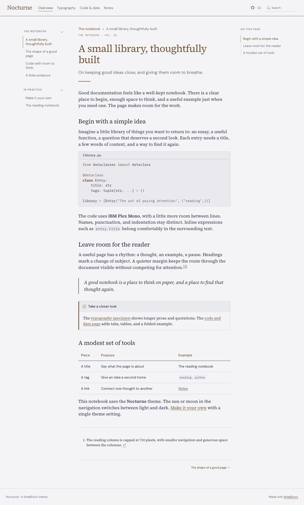
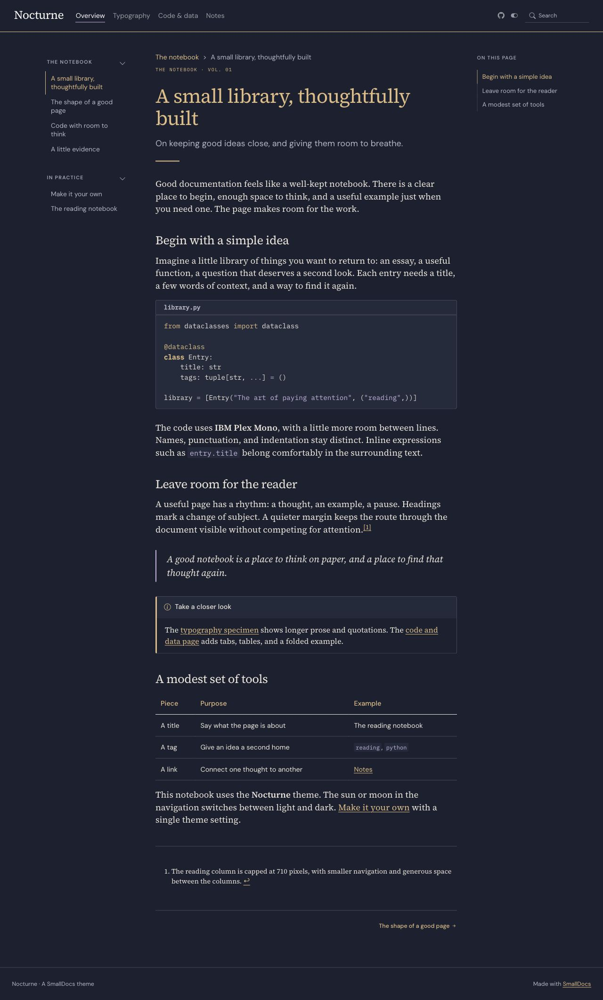

# smalldocs-nocturne

Midnight ink, warm brass, and a literary serif. Made for focused reading, with a pearl-paper light mode. A complete [SmallDocs](https://github.com/rahuldave/smalldocs)
theme with light and dark modes, bundled fonts, and a corresponding Quarto extension.

**[See the example site](https://rahuldave.com/smalldocs-nocturne/)** ·
[Light](https://rahuldave.com/smalldocs-nocturne/?mode=light) ·
[Dark](https://rahuldave.com/smalldocs-nocturne/?mode=dark)

| Light | Dark |
|:------|:-----|
|  |  |

Code uses **IBM Plex Mono** in both modes. Fonts ship with the extension; the theme
makes no requests to an external font service. The reading column is 640px wide,
with smaller navigation and a compact table of contents.

## With SmallDocs

In your documentation project:

```sh
smalldocs add rahuldave/smalldocs-nocturne
```

Set the theme in `_smalldocs.yml`:

```yaml
theme: nocturne
```

In a `_quarto.yml` that SmallDocs builds, put the setting under `smalldocs:`:

```yaml
smalldocs:
  theme: nocturne
```

The normal SmallDocs navigation button switches between light and dark.
Installing the theme requires no Sass compiler or font downloads.
`smalldocs themes` lists the project's installed themes.

## With Quarto

```sh
quarto add rahuldave/smalldocs-nocturne
```

```yaml
format:
  nocturne-html:
    toc: true
```

Quarto uses layered Sass and embeds the fonts as data URIs. Its theme follows the
browser's color preference and supports Quarto's light/dark toggle.

## Editable sources and builds

The compiled files in `_extensions/nocturne/` are committed for installation. Edit
`src/` and rebuild them; do not edit the compiled files by hand.

| Source | Purpose |
|:-------|:--------|
| `src/theme.json` | Both palettes, heading and body font choices, and theme metadata |
| `src/common.css` | Typography, navigation, code, tables, figures, callouts, and listings |
| `src/design.css` | Nocturne's distinctive headings, rules, and spacing |
| `src/fonts.css` | Local font-face declarations |
| `src/font-sources.json` | The pinned upstream URLs of the bundled font files |
| `src/quarto.css` | Adaptations for Quarto's own layout |
| `src/smalldocs.yml`, `src/_extension.yml`, `src/logo.svg` | Authored extension manifests and favicon |
| `vendor/bootstrap/` | Bootstrap 5.3.8 and its MIT license |
| `vendor/fonts/` | Original font files and their SIL Open Font License notices |
| `scripts/build.py`, `scripts/dark_root.py` | Offline, reproducible theme build and Bootstrap dark-mode adaptation |

Build with Python's standard library, from any directory:

```sh
sh scripts/build.sh
```

This writes two complete Bootstrap stylesheets (`nocturne.css` and `nocturne-dark.css`),
two layered Quarto Sass files (`nocturne.scss` and `nocturne-dark.scss`), manifests,
fonts, and licenses into `_extensions/nocturne/`. Like the Tufte theme, each CSS file
contains all of Bootstrap, so it can also replace `bootstrap.min.css` on an
ordinary Bootstrap page. Keep its `fonts/` folder beside it.

Normal builds work offline. `python3 scripts/fetch_fonts.py` can restore the
bundled font files from the exact upstream URLs in `src/font-sources.json`.

## The example site and GitHub Pages

`example/` contains the editable Markdown pages and `_smalldocs.yml`. It is a
normal SmallDocs website, with typography, code, figures, and a notes listing.

```sh
uv sync --group dev
uv run python scripts/build_demo.py
```

That script rebuilds the theme, copies it into the ignored `example/_extensions/`
folder, and runs `smalldocs render example --strict`. The HTML goes to
`example/_site/`; no HTML is hand-maintained.

To use the theme installer against this repository's current commit instead:

```sh
smalldocs add . --dir example --force
smalldocs render example --strict
```

Publish the rendered site to the separate `gh-pages` branch, as in
[smalldocs-tufte](https://github.com/rahuldave/smalldocs-tufte):

```sh
uv run smalldocs publish gh-pages example --no-render
```

GitHub Pages serves `gh-pages` from `/`. The source branch is `main`. The ignored
build output and copied extensions are kept out of `main`.

`just serve` builds and serves a local preview. `just publish` builds and publishes.

## Checks

```sh
uv run pytest -q
```

The tests check Bootstrap's component and variable contract, both color modes,
local fonts and asset paths, and installation into a fresh SmallDocs site. GitHub
Actions also rebuilds the theme and fails if the compiled files differ from their
sources, then renders the example site with strict checks.

## Credits and licenses

Theme code and example pages: MIT, Rahul Dave. Bootstrap: MIT. Fonts:
DM Sans, IBM Plex Mono, Source Serif 4, SIL Open Font License 1.1. All notices are included.
The repository and publishing structure follow `smalldocs-tufte`.

## Reading refinement (0.2.0)

The original version is tagged `before-reading-redesign-2026-10-16`. This revision
keeps the palette and font pairing, with 1.45 prose leading, a 640px reading
column, quieter headings, and 14.45px code on desktop and phones. Navigation and
captions are larger. Outline actions, secondary actions, check/radio marks,
focus treatments, and callout icons now use the theme palette in both modes.

The [comparison gallery](https://rahuldave.com/elegant-themes/?group=comparisons)
keeps the original and refined versions alongside one another.
