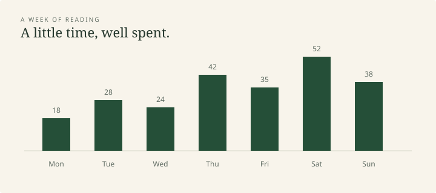

## A figure in the text

A figure should belong to the page. This simple chart uses the theme's
palette and shows a small set of illustrative observations.

{#fig-reading}

## Context matters

These values are invented for this specimen. The caption gives the figure
a name, and the surrounding text explains why it is here.

| Day | Minutes | A note |
|:----|--------:|:-------|
| Monday | 18 | A short essay |
| Wednesday | 24 | Returning to a passage |
| Friday | 35 | Notes and a new chapter |
| Sunday | 38 | A quiet afternoon |

::: {.callout-note}
## A figure's place
Images scale with the reading column. Wide tables scroll inside their own
frame on small screens.
:::
